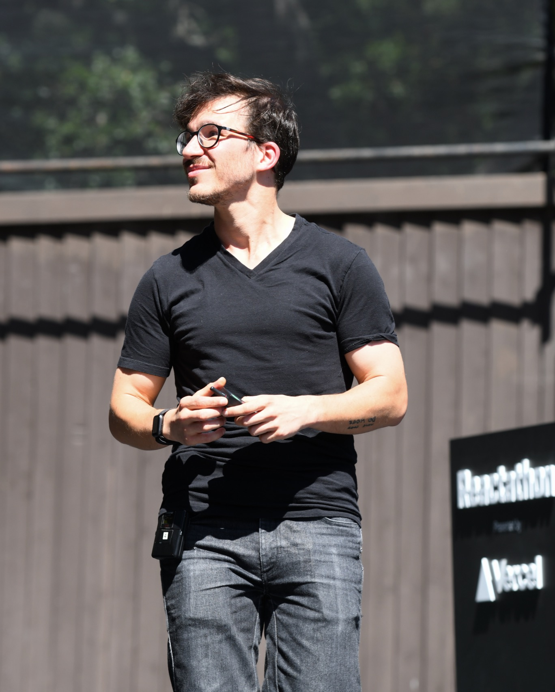

import { NewsletterSignup } from "@/components/newsletter-signup"

👋 Hi, I'm Swizec — a geek with a hat.

I'm a software engineer, author, and conference speaker. I build software at Plasmidsaurus and share lessons from two decades of building for the web: shipping in hypergrowth startups, growing teams, and making systems useful. Without the fluff.

## How I got here

I started out building websites for $7/hour in Slovenia, looking for a "real" engineering job and wondering how people made it into Silicon Valley. Eventually I got there. Then I had to learn how to be useful when the stakes got bigger 😅

My work has taken me through startups in education, healthcare, and biotech. At Tia, I helped rebuild the patient experience in React and TypeScript while the company and engineering team grew. In 2024, [I joined Plasmidsaurus](/blog/some-personal-news/) to build software for gene sequencing.

These days I'm learning what it takes to lead a growing team, understand how scientists work, and keep software running while the business keeps changing. AI has changed how we write code. We're still responsible for what ships.

## Why I write

The work comes first. The writing comes from figuring things out, making mistakes, and seeing what holds up in production.

How do you rewrite a system while customers are using it? How do you help a team ship faster as it grows? What changes when AI can write most of the code? How do you earn the trust to take on bigger problems?

Those are the questions I keep coming back to. I write down what I learn so you can use it in your own work. Sometimes that's a TypeScript trick. Sometimes it's a hard conversation or realizing you've been solving the wrong problem.

**My goal is to help you become an engineer people trust with the hard stuff.** The technical decisions, the people, and the responsibility for making it work.

## Where to start

- **[Scaling Fast](https://scalingfastbook.com)** brings together my lessons on growing a startup's business, team, and technology. You can also explore the [essays behind the book](/scaling-fast/).
- **[Senior Engineer Mindset](/senior-mindset)** is about ownership, judgment, and earning the autonomy to do bigger things.
- **[Serverless Handbook](https://serverlesshandbook.dev)** helps frontend engineers build backends with JavaScript, TypeScript, and serverless systems.
- **[My writing on AI](/categories/ai/)** follows what changes when coding agents become part of everyday engineering work.

For everything else, browse the [latest articles](/blog/), [books](/books), and [courses](/courses).

## Let's talk

Have a question, a story from your team, or an idea for a conversation? Email me at **[hi@swizec.com](mailto:hi@swizec.com)**.

I also give [talks](/talks) and teach [workshops](/workshops). For an invitation, include your topic, audience, format, and date. My policy is to say Yes as much as possible.

For bios, photos, interview topics, and select appearances, visit the [press & media page](/press).

You can also find me on [Bluesky](https://bsky.app/profile/swizec.com), [X / Twitter](https://twitter.com/swizec), [LinkedIn](https://www.linkedin.com/in/swizec), [GitHub](https://github.com/swizec), and [YouTube](https://www.youtube.com/@SwizecTeller).

<NewsletterSignup headline="Get the next lesson in your inbox" description="I write about the code, decisions, and people behind shipping software. Join me as I figure things out." />
