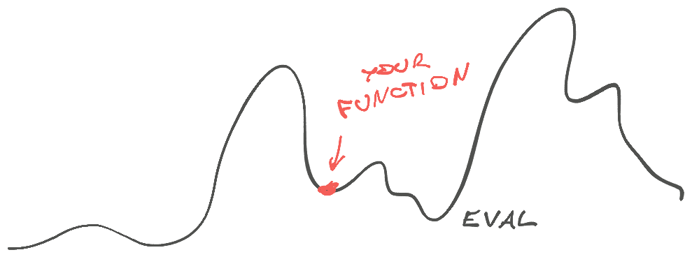
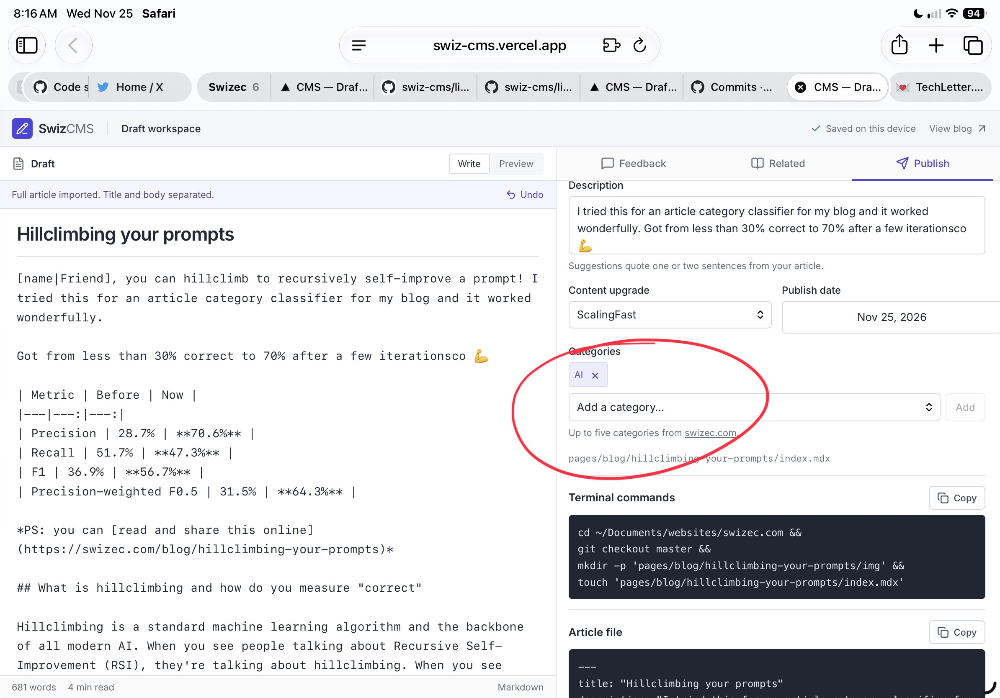

\[name|Friend], you can hillclimb to recursively self-improve a prompt! I tried this for an article category classifier for my blog and it worked wonderfully.

Got from less than 30% precision to 70% after a few iterations 💪

| Metric                  | Before |       Now |
| ----------------------- | -----: | --------: |
| Precision               |  28.7% | **70.6%** |
| Recall                  |  51.7% | **47.3%** |
| F1                      |  36.9% | **56.7%** |
| Precision-weighted F0.5 |  31.5% | **64.3%** |

Part of this was realizing that my categories were a mess and merging overlaps. But I wouldn't notice without the classifier saying "hey this is impossible".

_PS: you can [read and share this online](https://swizec.com/blog/hillclimbing-your-prompts)_

## What is hillclimbing and how do you measure "correct"

Hillclimbing is a basic machine learning algorithm behind a lot of modern AI. You make a change, see if results improve, keep going until improvements stop.

Decades of research have gone into different strategies to make this faster and less prone to getting stuck at a local optimum. You can look those up, it's a fun field :)

**But measuring "correct" is hard**. A perfect score on suggesting categories for 1 article is useless if it means zero hits everywhere else. _And_ you get a different output on every run.

So we use **precision** to measure how many suggestions that the algorithm made actually match the dataset and **recall** to measure how many of the known categories it actually suggested.

F2, F1 and F0.5 are combined metrics that turn precision and recall into a single number with emphasis on recall, neither, or precision.

## How that applies to prompt engineering

Normally you'd use hillclimbing to update weights in a model of some sort but you can apply the same technique at a higher level of abstraction – your prompt!

My [blog category classifier](https://github.com/Swizec/swiz-cms/blob/main/lib/server/classification-candidates.ts) works by taking a known list of categories and their descriptions then feeding that into a [decision model](https://swizec.com/blog/why-im-excited-about-jev-like-classifiers) alongside an article and asking, paraphrased, _"What categories fit here?"_

### How I prompt engineered a useful category suggester

To build the category suggester I started with a dataset of a few hundred articles from my blog. Yay for regular publishing over the years!

There's been some category drift over the years so I focused on the past 5 years. That's 359 articles and fuck me if I can verbalize how categories are used. It's all been vibes-of-the-day two minutes before you hit publish 😅

So I asked Astra to analyze the articles and write a decision prompt based on what it looks like each category means when you try to understand the associated articles. It did okay.

We got a [category-catalog](https://github.com/Swizec/swiz-cms/blob/main/lib/server/category-catalog.json) with 130 categories, descriptions, and example articles.

As soon as I used that first version it felt off. The categories didn't vibe.

Now here's the cool part: I asked Astra _"Hey this sucks, iterate on the prompt until it's good"_. And that worked 🤯

Astra split the dataset into 63 eval articles and ~300 it used to train the prompt. Then it hillclimbed for about 2 hours, kept tweaking the category catalog, and measured recall+precision on each iteration.

When that looked good, it used the 63 articles to give a final "how good we got" evaluation. This helps to prevent overfitting on the training set.

I can't show you how the prompt changed because I lost the diff in a rebase, but it looked almost random. Little variations in phrasing that to my human brain felt the same.

Upon reviewing the updated category catalog I found a few overlaps like leadership/management and compensation/salary where the dataset was more wrong than the prompt. Merged those and after another loop of hillclimbing the classifier improved from 51% to 71% precision. Huge success.

Now I want to try this to classify migrations as safe-to-merge or needs-review at work 😈

Cheers,
\~Swizec

PS: some say the future of software engineering is to design evals and let your agents hillclimb towards a successful product. I don't know if that's true, the suits have been trying this for decades (OKRs etc) and it hasn't worked. You still need taste and direction, can't let math take the wheel.

\[sparkjoy|hillclimbing-your-prompts]
