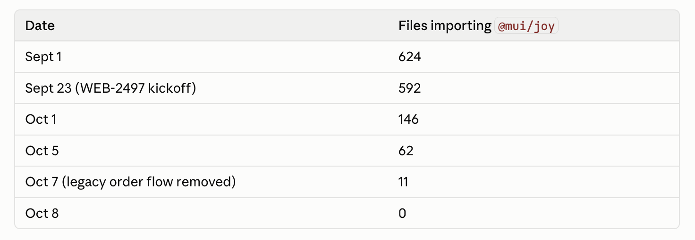

# No more tech debt

For the first time in my career we _completed_ a design system migration. The new math on big rewrites tickles my soul.

As I like to say: at scale you are always mid-migration, mid-rewrite, mid-wowthiscodeisbad. Your company changes every few months and the systems you built 2 years ago are no longer fit for purpose.

How you handle these migrations is everything.

## Why even rewrite

Rewriting your code is always strategic. It provides little to no value on its own, but you hope it unlocks new capabilities later.

For example our design system migration allowed us to:

- unify styles across different tech stacks (React, HTMX, plain ole jinja)
- remove a now-unsupported component library (JoyUI)
- build a rich component library so everyone can build good looking UI
- clean up old sins
- consistently apply lessons learned
- use technologies that LLMs are better at

JoyUI is based on a CSS-in-JS approach that compiles to pure CSS. We liked the ergonomics in React but it was clunky to use in our more traditional Jinja and HTMX pages. So we never did.

Over time our software became a mix of Bootstrap, hand-rolled CSS, AI vibed styles, and React pages that kinda followed our design system. We kept missing good baseline components and nobody had time to build them and so even the UI that superficially followed a design system felt clunky and incoherent.

## Engineers are busy, not lazy

Product engineers are judged based on features delivered and customers delighted. They'll do their best to follow established patterns and keep things clean, but you cannot expect them to go miles out of their way to Do It Right.

If [desire paths](https://www.reddit.com/r/DesirePath/) make your code look bad, that's on you. Systems devolve into a mess when the cost of keeping them clean is too high.

Every weird component, poorly styled page, and inconsistently applied convention was a desire path saying the tools aren't there. Engineers can't grab components off the shelf, they can't find the right conventions to follow, they're applying first principles instead of focusing on their features.

So yeah, every page and component looked like it was designed by a different person. Because it was.

## Create tools then let it rip

We started with a few baby steps:

1. A customized Tailwind skin that looks like our brand colors
2. Minimal ShadCN + BaseUI component library
3. Basic setup to ensure old and new components can live on the same page without looking awful – a little janky is okay, awful is not
4. A `DESIGN.md` file explaining the migration path
5. A [few basic linters](https://swizec.com/blog/stop-burning-tokens-on-code-review) to force us into using the design system instead of styling components from scratch

Then we ripped [a big bang migration](https://swizec.com/blog/agents-change-the-math-on-big-bang-migrations) that rewrote all our Jinja and HTMX styles in one big pull request. Merged that and followed it up with 2 days of fixing little bugs.

For each bug fix we evaluated if something's missing in the design system or `.md` guidance and made updates.

After that we let the system marinate.

For about a month folks added more components to the library, fixed inconsistencies, polished instructions when agents made mistakes, updated linters to catch common issues, and kept rewriting the UI page by page.

Then, when we started getting consistently good results to _"Hey agent, rewrite this page in ShadCN, follow the new design system, keep all functionality, make sure you add before and after screenshots to the pull request"_ it was time to let 'er rip again.

At one point I let Claude rip for 6 or 7 hours to migrate a few major sections of the website. That's the **drop from 592 files importing `@mui/joy` to 146 files in a week** you see in the screenshot above 😈

45 pull requests across 8 stacks. It was glorious. The trick was asking for before and after screenshots so we could visually compare and validate and telling Claude to migrate in vertical slices. Each pull request would migrate a single page and could be merged without disrupting anyone.

After that it took us another week to clean up the final few files. High impact first, then find all the stragglers.

## The cleanup matters

We wanted to _leave no trace of the old design system_. This seems aggressive but it's super important when everyone uses agents to write their code.

Agents amplify the codebase you already have They do not think from first principles and are pretty bad at applying better patterns without heavy hand holding. But they're great at _"hey build this feature following patterns from that feature over there"_.

So you have to make sure everything's clean. Delete the old code, migrate everything. Now any engineer can build good stuff without having to worry about what that means. Agents just do it right.

Cheers, 
\~Swizec
