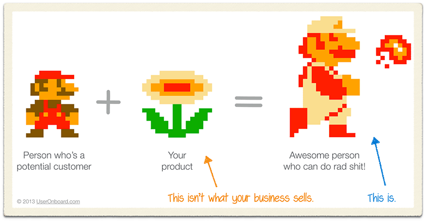

Software is never the goal, what software can help you do is the goal.

When was the last time you got out of bed in the morning and thought _"What a fine day to buy some software"_. Then you went to the software store and bought yourself a bag of the finest software, brought it home, and just admired the thing. What beautiful software, just sitting there looking all shiny and cute.

Weird, right?

_Software is a tool_, it has no intrinsic value. You buy software because of what it can help you do. The value is in doing the thing.

But historically software has been expensive to produce. This has bamboozled many of us into thinking code intrinsically has value.

Yes there is moat in having built software to solve a problem. You can sell your software to people with a similar problem so they can:

- move faster by buying your code
- buy yours cheaper than it takes to build their own
- trust you to keep innovating
- save on training with standardized tools
- trust you to do maintenance and stay up

That's SaaS – software as a service. Users [buy your service, not your code](https://swizec.com/blog/users-buy-your-service-not-your-code).

You'll notice this maps to the sales world insight that [people buy 4 things and 4 things only](https://news.ycombinator.com/item?id=23285438):

1. time
2. money
3. approval/peace of mind
4. sex/status

I agree, software rarely helps with 4.

I'm telling you this because the cost of producing software is collapsing. Every day I look at the vendors we use and wonder should we just build the 10% of features we actually use?

So far, building our own feels like a distraction, but our bandwidth keeps growing. At least 4 people have built their own tiny github clone because "it doesn't do PRs just the way I like". Others do everything through MCP and never look at anyone's UI. We ship features every month that a few years ago would be a whole-ass startup.

My thinking these days is to buy first, iterate quickly to a working solution, then build our own as customization needs grow. You still [can't buy integration](https://martinfowler.com/articles/cant-buy-integration.html), but if you can cheaply create just what you need ...

It's wild out there, one good engineer with autonomy can out-ship entire departments stacked to the gills with solid engineers conducting duties with a workmanlike performance.

Now go out there and code code code.

Cheers, 
\~Swizec
