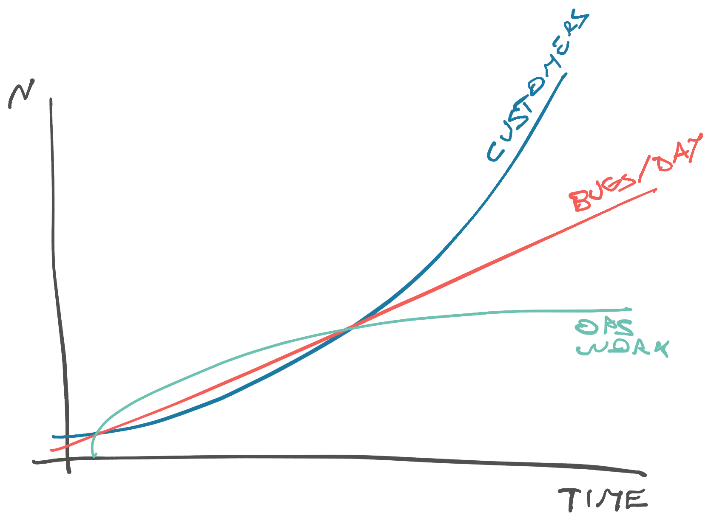
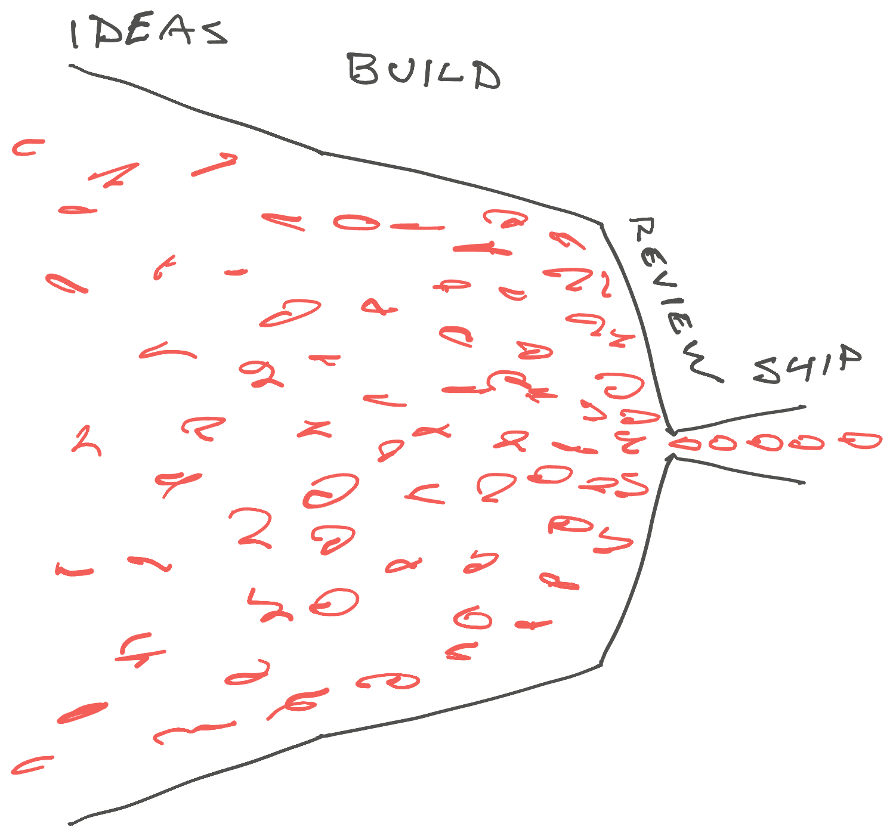

> Dude what are you doing!? Install Cursor and stop wasting our time, do you have any idea how much money you're burning

That was my wake up call: This company is different. Shipping fast is not just something we say, we _ship fast_. Every day, multiple times per day, even Fridays at 5pm.

You might think that's cute but for a 21-person engineering org we ship with a velocity I wouldn't think possible 2 years ago when my young whippersnapper boss told me off for writing code the old fashioned way.

We now auto-approve and merge [16% of all pull requests](https://swizec.com/blog/we-now-auto-approve-and-merge-15p-of-prs), [perform big-bang migrations](https://swizec.com/blog/agents-change-the-math-on-big-bang-migrations), ship a few hundred PRs every week, handle 1000 line pull requests like it's normal, and [AI writes 97% of my code](https://swizec.com/blog/ai-now-writes-97-of-my-code-heres-what-i-learned). Mostly without blowing things up in an operations heavy business where an outage can measure in thousands of dollars.

I haven't had this much fun since coding in Turbo Pascal after school every day. Here's how we do it and what has changed in our engineering culture since 2024.

## Accountability comes first

Everything I'm about to describe works because we have a high accountability high agency culture. We don't care how you wrote the code, but you're signing that thing with your phone number.

https://x.com/Swizec/status/2018750989445263600

When you ship a system to production, it's yours to keep running. When you build a feature, it's yours to make effective. We expect every engineer to talk to users, [watch stakeholders work](https://swizec.com/blog/watch-people-work), and own their code. There are no "translate english into code" developers on our team. We have AI for that.

If you accept that deal, we almost never say No to an idea. Ship first ask questions later. We love frustration-driven development and many of our coolest features come from engineers trying something interesting that nobody else thought possible.

Of course if your initial idea looks promising we'll give you time and space to flesh it out.

## How engineering has changed

When I joined Plasmidsaurus, AI coding was starting to get good. We had smart autocomplete that was half useful half annoying as hell. You had to fight your editor to finish a thought and triple check everything it wrote.

Nobody was sure if using AI made them faster or slower. We all agreed it feels like magic when it works, but adds a lot of friction when your editor hallucinates a method that doesn't exist. Just talk to the language server damn it!

My favorite use-case was translating SQL queries into SQLAlchemy code. Plasmidsaurus was built in a stack I hadn't used for 10 years (Flask+SQLAlchemy) and never this seriously. Using AI made translating my general software engineering experience into stack-specific language a lot more accessible.

Even now I prefer to think in SQL and translate into the awkward python syntax that our stack prefers.

### Early vibe coding

By late 2024, vibe coding started to become viable. You could [coach your AI to write simple code](https://swizec.com/blog/coaching-ai-to-write-your-code), but it was awkward. Best way I knew was to manually copypaste things in and out of ChatGPT.

You'd describe your context, paste-in useful bits of code, and ask for a working script. Scripts could kinda run in the cloud for testing but the whole practice was clunky.

You couldn't vibe code as your main way to build product. I loved it for code that was quick to verify and cumbersome to generate. Like database migrations and little administrative scripts. Anything where writing the code takes you out of the flow on your primary task.

It's easier to say _"Here's our DB schema, add this new concept and foreign keys to A, B, C"_ than to stop thinking about the architecture and write all that out by hand. You'll know it works in 5 seconds, half of which is python startup time.

### The start of delegating tasks

For me, the first big shift happened in July 2025 when [Cursor launched background agents](https://swizec.com/blog/cursor-background-agents-in-slack-changed-my-workflow). You could now delegate whole tasks to a machine!

My biggest gripe with vibe coding is that I watch the machine work. You write a prompt and wow look at the AI go it's thinking so hard! You watch the chain-of-thought, you watch the tool calls, the code materializing, the mis-steps, and the way it tries to test its work. My baby 🥺

But that's a waste of time. You wouldn't hire a plumber then watch over their shoulder as they fix your sink. The whole point of hiring help is to buy back your time.

Background agents let you fire off a task and come back when it's done. Review the pull request – code, screenshots, demo videos – then leave followup instructions right there in the comments. It's like working with a fellow engineer.

## The biggest impact is on the tail-end

Agentic development changes the economics of building software.

We're building more software than ever and I doubt we achieve more top-line company priority goals than we could without AI. The features are more complete and polished because we have more bandwidth to invest, but tech is a red queen's race and our goal posts moved. What counts as an MVP in 2026 would've been a polished high production feature with a 6 month roadmap in 2020.

The biggest impact has been on the tail-end, the bugs and features that a few years ago nobody would've prioritized.

Our main goals as an engineering org are twofold:

1. Build the product
2. Make the business more operationally efficient

Product is what we sell, operational efficiency is how we survive hyper growth. Without this you drown in running the business instead of building the software, get a flaky reputation because of bugs and slow support responses, and customers stop coming.

10 clicks to update a thing is fine once a week but killer when it's 50 times per day. 1 in a million bugs are fine when you have 5 customers and killer when you serve 50 requests per second.

Becoming operationally more effective mostly looks like boring work around the edges. You have to relentlessly remove friction from the system.

You want every engineer to improve the process of running your business. For this I like to encourage frustration-driven development.

Tired of managing feature flags in the database? Ask an agent to build you a control panel. Tired of navigating internal tooling through clunky menus? Tell an agent to build a Cmd+K quick search feature. Tired of managing employee roles and permissions? `@cursor make me a tool`. Annoyed with _"Can you just pull this data for me real quick?"_ – never let business users realize you know sql lol – build a quick dashboard.

Any time you repeatedly answer a question or do a task, you can automate yourself out of the chain with a quick prompt. With background agents, you don't even need to get distracted from your main task so there's no need to ask for permission.

You think we need a tool that makes your life easier? Make it so. Seeing stakeholders waste their time on some bullshit? Fix it.

If you can describe the problem, you can put an agent to work. Ask for screenshots and videos of the working feature so it's quick to review. Ship first ask questions later. For self-contained features like this code quality can wait.

We find a lot of opportunities for quick fixes by watching our stakeholders work. And the more friction we fix, the more people come to us with their problems. You never want users to get complacent and resigned into the drudgery – good work software feels invisible and gets out of the way.

## Starting got easy but finishing is still hard

The flip-side of your ability to have agents work on anything in the background is that work in progress still kills your progress. The more that's on your mind the less progress you make on any individual task.

And it sneaks up on you too!

You start the day with a goal in mind. Then someone pings you on Slack with a quick ask. Yeah sounds easy, `@cursor make it so`. Then a user reports a tiny little bug. Sure quick and easy, `@cursor fix this`. Then you have a 2 hour block of meetings and think might as well set Claude loose on these two big tasks I meant to do today. While talking to stakeholders you get an idea that would make everything from all those meetings so much easier or even unnecessary – I love deleting stupid steps out of a business process – so you type up a quick 300 word prompt to describe the context and the idea and a rough implementation plan and somehow that takes 20 minutes.

Now it's 3pm and you have 6 pull requests open in draft. You look at the quick fixes merge one and realize Cursor completely misunderstood the other. Try again. The big tasks you had Claude work on in the background look _"almost salvageable"_.

You've come too far to give up and fire off a few more prompts. Fix behavior you forgot to specify, improve the code structure so it makes sense, remind Claude that you don't need tests to verify never-merged behavior was removed, eventually test the feature.

In the words of Knuth, _"Beware of bugs in the above code; I have only proved it correct, not tried it"_. I don't trust code I didn't see working with my own eyes.

Even with agents generating screenshots and walkthrough videos, you gotta at least do a happy path smoke test. Good way to find little UX friction to fix before you ship.

End of day comes and you've done a lot of work but only shipped a small bugfix. Your main priorities barely budged.

When software generation becomes cheap, you can work on anything and everything feels worth the effort. That's the trap. You have to relentlessly focus on your main priorities and say _Not Yet_ to everything else. Give yourself a small daily budget for ad-hoc fixes and throw everything else on triage.

Half the work we prioritize each sprint comes through triage. I ask my engineers to keep an eye out because I can't be in every room.

But if it's a quick copy or color change please don't spend 20 minutes weighing priorities.

## Code review is the highest leverage for senior talent

Nobody cares how fast or how much code you produce. What did you ship to production that users can see? What can users do today that they couldn't yesterday?

But you can't ship slop.

Modern devops has made shipping quick – you click a button and robots do their thing. Agentic coding has made producing code easy – you describe the problem and wait.

Review is now the bottleneck and it matters more than ever. I don't mean just code review, I also mean making sure features achieve their goal, work well together, and your product doesn't look like it was thrown together by a bunch of raccoons on meth.

### Product debt

Product debt is a big danger when everyone can ship any idea.

Every user thinks your app would be way better if it didn't have all those useless features that get in their way. Except no two users agree which of the features are useless. 🫠

At Plasmidsaurus we have a lot of monster pages that load slow and do too much. Every time we try to hide a table column or move a widget, an army of angry stakeholders comes out of the woodwork to say those were the most important pixels they look at every day.

And with our high agency culture, every feature and screen look different – hyper-focused on solving the current problem. Individual engineers work with users to build a fantastic, or at least good enough, UX for their particular feature and forget to think about the whole. Repeat this a few times and users complain that your software looks clunky but they're not sure why.

It's because every feature feels like a new learning curve. This also creates users afraid of trying the new and improved workflows you build. Best stay with the old method they know works.

And now you have to maintain all this cruft.

Ship a feature every week for a year and you have 52 production features to keep running. If each feature has a 0.5% chance of hitting a bug tomorrow and it takes 3 hours to identify and fix, you're spending almost a whole day every week fixing bugs. Realistically you'll let them fester until it's a big problem.

You can fight this with product review.

Review user experience end-to-end, kill features that don't work, build design systems and component libraries. Engineers and agents shouldn't have to reinvent basic interactions from first principles for every new feature.

### Code quality is money

> In the beginning, architecture slows you down.
> As you grow, lack of architecture slows you down

Adding agents is like upsizing your engineering org 10x. They amplify the code quality you've got.

Build a [giant ball of mud](https://www.laputan.org/mud/mud.html) and agents are happy to continue in the muck. Create a structured system with separation of concerns and clear contracts between modules and agents will follow the pattern.

But for the first time in my career, we can put a clear dollar cost to the bad code tradeoff! In one experiment, better file structure [reduced token cost by 83%](https://martinfowler.com/articles/exploring-gen-ai/refactoring-economic-benefit.html) on a coding task.

The less code your agents have to read and touch to make a change, the fewer tokens they burn. The more navigable your code structure, the quicker agents get to where they need. If it's good for humans it's good for LLMs!

Sounds obvious but it means that in a company of vibe coders _someone_ has to look at the code and enforce quality.

This means vertical domain-oriented modules, clear contracts, good abstractions, and colocated code that works together. Call it context engineering if you're building your resume.

Agents in my experience are bad at this.

As David K Piano once said – _"AI wasn't trained on good code, it was trained on your code"_. Claude loves horizontal slices and writing lasagna code, Codex writes code that's too clever, and Cursor has different quirks every day.

Your best bet is to ask agents to follow an existing pattern.

## Review the code, build the system

The job of a senior+ engineer is increasingly to build the system that generates the software. Not a "software factory", a socio-technical system where humans and agents can work together.

You have to read the code others produce.

I've been averaging 40 to 50 code reviews every week for months. Half my Github contributions are code review and even the code I write is mainly me reviewing agents' code. Yes it's exhausting.

And it's the highest leverage activity I can find. Here's why.

### Agentic code review lacks judgement

We've tried agentic code review and it's ... okay. You get lots of words and decent pointers but you have to review the review. We reject half the comments BugBot makes as irrelevant or not yet important. Building our own was even worse.

You need human judgement _and current project context_. The code quality you need for a core product feature that you'll bet the company on is not the same as a throwaway internal feature that 5 folks will use once a month. Review bots don't understand that.

Review bots also don't understand your business context and desired architecture. Best they can do is nudge towards generic patterns and "best practices".

And agents won't find problematic patterns and desire paths in your architecture. Agents are like a hard worker with infinite fortitude. Ask them to dig through a concrete wall with a spork and they'll get it done.

_You_ have to watch them work and notice where it's awkward.

### Turn manual review into rules

Once you spot the awkward patterns, agentic coding is your architectural super power. Because agents read the guidance you write! Every time 😍

The problem with playing architect has always been that nobody has time to read the docs or follow an SOP. With great effort you can spread the good word but most architects burn out.

When everyone uses agents, you update one `.md` file and every pull request thereafter follows the new pattern. This has been fantastic yet dangerous.

Unlike humans, agents don't understand the spirit of your rules. Tell them that testing parsers is high value and they'll write unit tests for every Zod schema. We don't need to test that a JSON-to-object library works.

For a long time I've been a skeptic of maintaining intricate `.md` files to guide agents – just talk to it! – but I've become convinced. You don't write those files for the agents, you write them for the less experienced engineers who don't know what to ask for. Now it happens automatically and by default 💪

The other high value outcome of reading everybody's code is to lean into your frustration and [build deterministic linters](https://swizec.com/blog/stop-burning-tokens-on-code-review) that warn and error against comments you write repeatedly. Custom linters are worth writing because software got cheap to build.

Describe a pattern in plain english and watch your agents write 700 lines of AST parsing magic that catches that pattern in milliseconds. Then add this to your CI and commit hooks.

We have a few dozen custom linters running across our stack and it's been wonderful. Humans can't merge until all checks are green, agents run the checks before they even commit the code.

Add a new rule every time you get tired of writing a new piece of feedback (show the agent specific PR examples so it can write a good lint) and increasingly your code review becomes a rubber-stamp. By the time a coworker looks at it, your linters and `.md` rules have fixed everything worth saying.

That's when you can safely add an auto-approve+merge automation. Why even look at low-risk code if it passed all your rules?

## In effect, everyone got promoted

Junior engineers that translate english into code don't exist and technology experts that assemble into a full-stack team are gone.

We expect everyone to talk to customers and stakeholders, understand the impact of their work, own features from concept to production, and iteratively improve the system. Your goal is to care, be accountable, and make users happy.

In effect we all work like staff+ engineers. Beginners own small domains with a few stakeholders, veterans own critical domains with lots of competing priorities and cross-cutting concerns that touch everything. Way more fun than punching Jira tickets.

When code is cheap judgement becomes the job.

Cheers, 
\~Swizec
